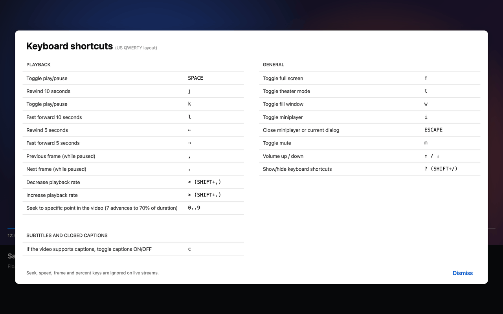

# Kifty

Keys from Tube That's Yours for Plane That Floats: a browser extension that adds video player hotkeys to the Floatplane.com



Press ? on a video page to see every shortcut in your browser's language.

| Key           | Action                                                      |
| ------------- | ----------------------------------------------------------- |
| K             | play / pause                                                |
| J             | seek back 10 seconds                                        |
| L             | seek forward 10 seconds                                     |
| ,             | previous frame (while paused, assumes 30 fps)               |
| .             | next frame (while paused, assumes 30 fps)                   |
| < (Shift + ,) | slower, one step down the 0.5x to 2x list                   |
| > (Shift + .) | faster, one step up the 0.5x to 2x list                     |
| 0 to 9        | seek to 0% to 90% of the video                              |
| T             | theater mode, relayed to the player's own "fill window"     |
| I             | miniplayer (Picture in Picture) on / off                    |
| Escape        | close the shortcuts overlay, otherwise leave the miniplayer |
| ? (Shift + /) | show / hide the keyboard shortcuts overlay                  |

The shortcuts overlay lists the player's built-in keys next to the extension's. It opens on any matched page, and pressing ? again, Escape, the Dismiss button or a click outside the card closes it. In fullscreen it is drawn above the video.

Hotkeys are laid out for a US QWERTY keyboard and use physical keys (`event.code`), whatever layout is active. Shift + / is always "?", even where the different layout types different character on that key, and the key where a US keyboard has K always plays and pauses. Layouts that move Latin letters, such as AZERTY or Dvorak, follow the QWERTY positions too, not the keycap labels.

Already provided by the player and left untouched: Space (play/pause), arrows (seek 5 s, volume), F (fullscreen), W (fill window), M (mute), C (captions).

Seek, speed, frame and percent keys are ignored on live streams, which matches the player's own behaviour.

The speed list is the same one the player shows in its "Playback speed" menu.

## If you using not published version

### Chrome, Brave, Edge

1. Open `chrome://extensions` (or `brave://extensions`, `edge://extensions`).
2. Turn on "Developer mode".
3. Click "Load unpacked" and select the `extension` folder of this repository.

### Safari

Safari only loads extensions wrapped in a macOS app. The `safari-app` folder holds an Xcode project generated with Apple's converter from the files in `extension`.

1. Build the app with the command under "Then build" below and open `safari-app/Kifty/build/Build/Products/Debug/Kifty.app` once so Safari registers the extension, or open `safari-app/Kifty/Kifty.xcodeproj` in Xcode and run the macOS target. The app is ad-hoc signed, so Gatekeeper may ask you to confirm the first launch.
2. In Safari, open Settings > Advanced and turn on "Show features for web developers", then choose Develop > Allow Unsigned Extensions. Safari asks for your password and resets this switch when it quits, so repeat it after each Safari restart while the extension is unsigned.
3. In Safari Settings > Extensions, enable "Kifty" and allow it on the sites it asks for.

To regenerate the Xcode project:

```
xcrun safari-web-extension-converter extension --project-location safari-app --app-name "Kifty" --bundle-identifier dev.vovadev.kifty --macos-only --no-open --no-prompt --copy-resources --force
rm "safari-app/Kifty/Kifty Extension/Resources/content.js"
```

The converter gives the app target the identifier `dev.vovadev.Kifty` while the extension gets `dev.vovadev.kifty.Extension`, and Xcode refuses to embed an extension whose identifier is not prefixed by the app's. After regenerating, set the app target's `PRODUCT_BUNDLE_IDENTIFIER` to `dev.vovadev.kifty` in both configurations. The converter also copies `content.js` into `Kifty Extension/Resources/`, which the `rm` above deletes, and points the project at that copy, so point it back at the shared file. Both fixes run from `safari-app/Kifty`, and `sed -i` takes a different form in macOS (BSD) sed and GNU sed, so use the line for the sed you have (`sed --version` prints a version only for GNU sed, which Homebrew's gnu-sed may put first in PATH).

macOS sed:

```
cd safari-app/Kifty
sed -i '' -e 's/dev\.vovadev\.Kifty\([;"]\)/dev.vovadev.kifty\1/g' -e 's|path = Resources/content\.js;|path = ../../../extension/content.js;|' Kifty.xcodeproj/project.pbxproj
```

GNU sed:

```
cd safari-app/Kifty
sed -i -e 's/dev\.vovadev\.Kifty\([;"]\)/dev.vovadev.kifty\1/g' -e 's|path = Resources/content\.js;|path = ../../../extension/content.js;|' Kifty.xcodeproj/project.pbxproj
```

Then build:

```
cd safari-app/Kifty
xcodebuild -project Kifty.xcodeproj -scheme Kifty -configuration Debug -derivedDataPath build CODE_SIGN_IDENTITY=- CODE_SIGN_STYLE=Manual DEVELOPMENT_TEAM= PROVISIONING_PROFILE_SPECIFIER= build
```

`manifest.json` and the icons are separate copies; after changing them in `extension`, copy `manifest.json`, `icon16.png`, `icon32.png`, `icon48.png` and `icon64.png` into `safari-app/Kifty/Kifty Extension/Resources/` and run the build command above.

## Known limits

- Speed keys change the rate of the current video only. The player keeps the rate for the next video in an internal settings store that a content script cannot reach, so persistence happens only through its own menu.
